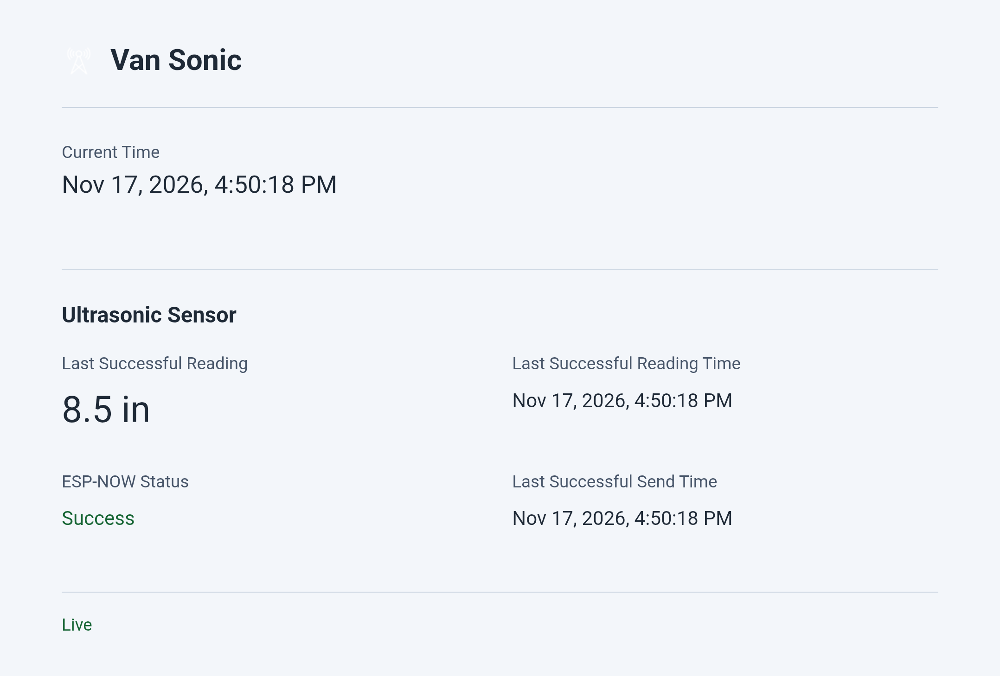
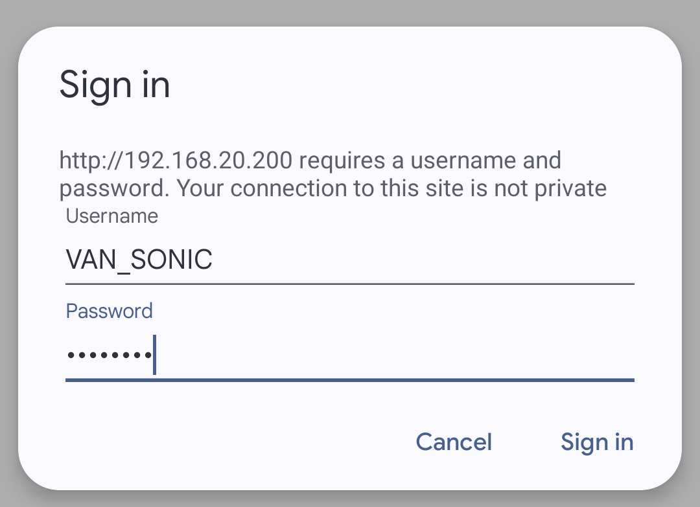
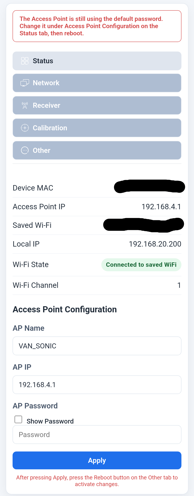
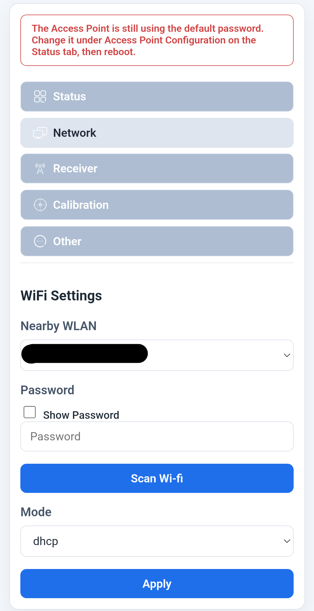
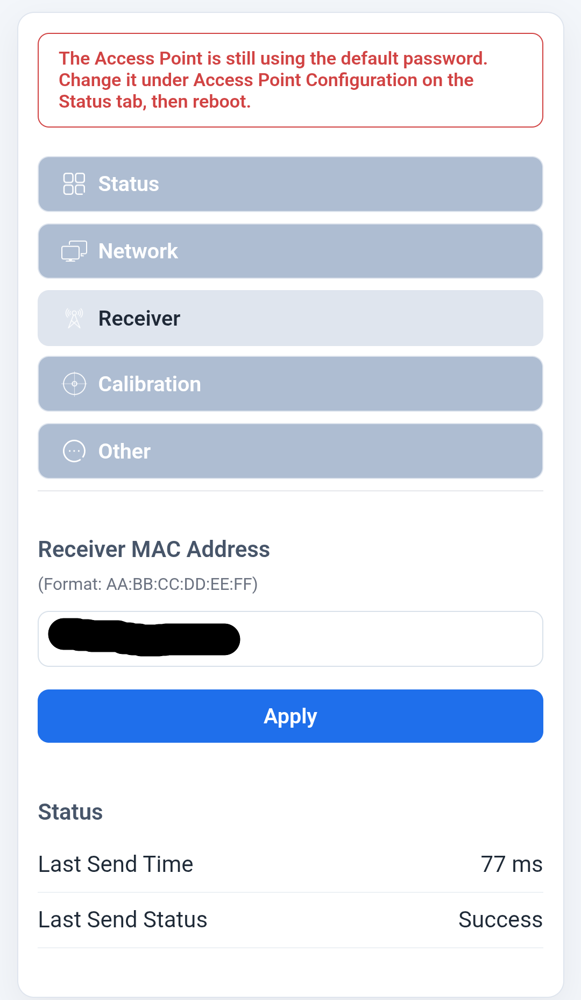
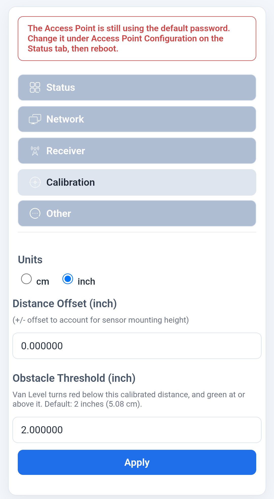
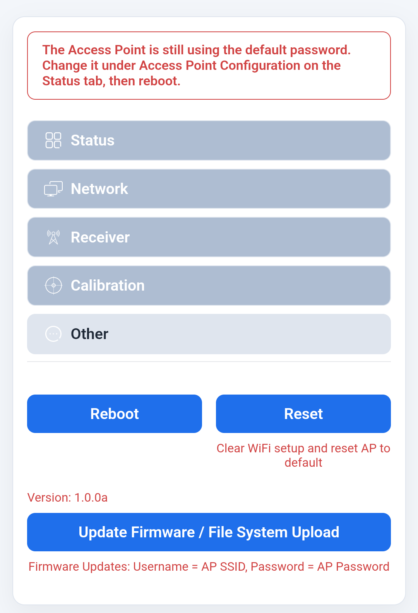
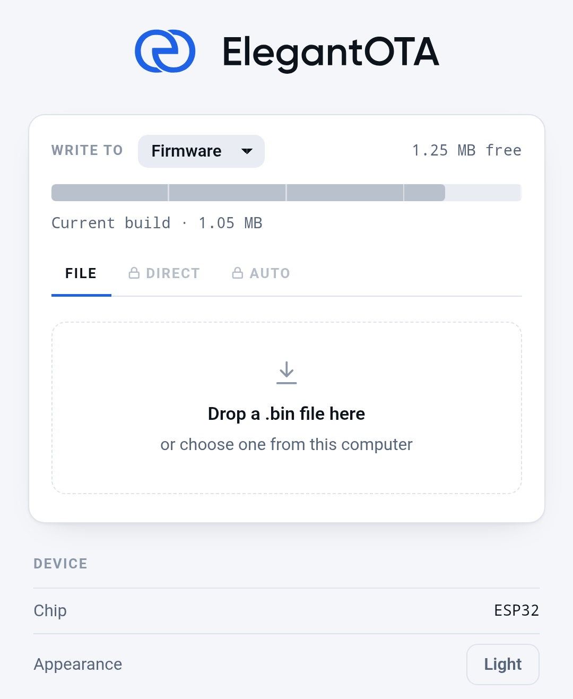

# Van Sonic

## Overview

ESP32 Based app to read a A02YYUW ultrasonic rangefinder and report the distance data via ESP-NOW to the companion Van Level app

## A02YYUW Configuration

- No sensor configuration should be necessary. We use the sensor's default binary UART mode: 9600 baud, 8N1.  Note that you need the `UW` version of the sensor.  This version outputs the sensor reading continuously over the serial datastream.  The UART Controlled version ending in `TW`, requires constant polling and will not work in this application.


## Product Images


## Project Structure

```text
├── CAD Model/                       # SolidWorks 3D model of the board and Hammond enclosure
├── Notes/                           # Datasheets and component references
├── Van_Sonic_App/Van_Sonic          # Arduino ESP32 source code
│                 └── data/          # App's LittleFS website
│                     └── images/
├── Van_Sonic_PCB/                   # Kicad board files
│   └── Component Models/            # STEP files of board components
├── HARDWARE.md                      # Hardware specifications and components
├── README.md                        # This file
└── SOFTWARE.md                      # Software description
```

## [Hardware](HARDWARE.md)

## [Software](SOFTWARE.md)

## Features
This application uses an ESP23 to read serial data from an ultrasonic rangefinder.  The resulting information in presented graphically via a self-hosted webpage and is also made available to the Van_Level application using the ESP-Now protocol.  To use ESP-Now, all devices must be on the same WiFi network and channel

The Wifi supports a standard network client, using either DHCP or static network setup, as well as a local Access Point for connecting directly to the device without a local network.

The rangefinder distances can be viewed using any browser that supports JavaScript. The webpage displays the current time, the time and value of the latest sensor reading, and the time and success/failure of the latest ESP-Now transmission.

## Getting Started

### 1. Hardware Setup
1. Connect the ESP32 board to 12V DC power via connector C1 observing correct polarity.
1. Connect to `VanSonic_nnnn` in your phone or computer's Wi-Fi settings. The `nnnn` suffix is the last four hexadecimal digits of the device's factory MAC address, without colons (for example, `VanSonic_0ABC`).
1. The default password for the access point is `12345678`.
1. You can change the access point name and password in `/setup`. Firmware updates preserve saved AP settings, including the old name if it was saved by earlier firmware.
1. Open the app webpage in any browser by navigating to the hotspot address `192.168.4.1`.
1. Your browser window should look something like this:
<br>

### 2. The Main Display
1. The image above is the standard display in landscape mode.  It will auto rotate for portrait and both views support your browser's `Dark Mode` setting.
1. The browser's current time is displayed along with the latest sensor reading from each sensor and its corresponding reading timestamp.  Below each reading is the status and timestamp of the last ESP-Now message back to the Van_Level app.  With any luck, you should observe all of the various timestamps incrementing.
1.  Finally, at the very bottom of the page, you should see the status of the ESP's WiFi connection.

### 3. AP Configuration
1. To connect the *Van Sonic* app to your local network, or to change the default access point address, name, and/or password, we need to connect to the configuration page.  Navigate your browser to `192.168.4.1/setup`.
1. You will be asked for a login name and password.  These are the same as the AP name and password initially, and can be easily changed later.
<br>
1. After pressing `Sign in`, your browser should now be displaying the app setup page with the `status` tab selected:
<br>
1. On this page, you can change the Access Point name, IP address, and password.
1. If you make changes to any of the AP settings, after hitting `Apply`, you will need to switch to the `Other` tab and select `Reboot` to enable the changes.
1. The setup page authorization name and password **are the same** as the AP name and password.  If you change the AP name and/or password on this page, remember the values so you can log into the device configuration later.
1. There will be an alert at the top of the page if you are using the default name and/or password.  For security reasons, it is best to change these to something uniquely yours.
1. If you forget your AP name or password, you will no longer be able to log into the `setup` page to make changes.  If this happens, you can reset the App to the original defaults by holding down the 'Boot' button on the ESP32 board for 5 seconds while the device reboots.

### 4. Network Configuration
1. The `Network` tab allows you to connect the *Van Sonic* app to your local network.  Pressing the `Scan Wi-Fi` button will search for all available access points.  When the scanning is finished, selecting the `Nearby WLAN` dropdown will present a list of all APs found allowing you to select one.
<br>
1. Enter the WiFi password for this network.
1. You can now select DHCP or Static network configuration.  After you have made your selections and filled in the network password, click `Apply`.  Changes are automatic and you do not need to restart the device.
1. You can switch back to the `Status` tab and verify your selected WiFi connection.

### 5. ESP-Now Receiver

1. Enter the MAC address of the `Van Level` ESP32 controller.  This value can be fount on the Van Level's setup page status tab.  In order for ESP-Now to work correctly, both `Van Level` and `Van Sonic` must be on the same WiFi network and network channel.  Press `Apply` to immediatly use these settings.
2. If the connection to the `Van Level` app is configured correctly, you should see a succesful send message and the send time should be incrementing. 

### 6. Calibration

1. Select the units you wish to use to report the distance values.
1. The `Distance Offset` is useful if the sensor is not mounted at the measurement reference point.
    >Note: The sensor has a blind zone of 3cm (1.5").  It will not sense objects closer than this.  Therefore, you should place your sensor at least this amount above your detection level and use the offset to correct the displayed reading.
1. Set `Obstacle Threshold` to the distance below which the `Van Level` display should change from green to red.  Distance is the value after the above offset has been applied.
1. Click the `Apply` button to immediately apply these changes.


### 6. Other

1.  `Reboot` will restart the Van Sonic device retaining all of your current settings.
1.  `Reset` will clear your stored Wifi network information and restore the default AP captive portal name and password.  **Make sure** this is what you want before pressing `Reset`.  If you have forgotten your AP name and password and can no longer access the configuration page because of this, it is possible to reset the hardware physically.  This process is discussed in [Software](SOFTWARE.md).
1. Selecting `Update Firmware / File System Upload` will allow *Over The Air* updating of the program and webpages.  See [Software](SOFTWARE.md) for more information on this process.
<br>
